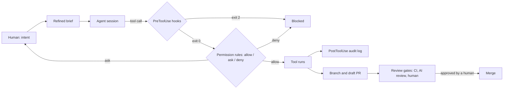

# Design

How the playbook is structured, and the model of control it teaches.

## The control model

An agent is useful when it can act: read code, run commands, push branches. It is safe when every action passes through controls that a human wrote, can read and can change by PR. The playbook calls that set of controls the harness.

Three properties hold at every maturity level above 1:

1. **The agent never holds the final say.** Merges, applies, deploys and anything outside the repo wait for a human.
2. **Every control is a file in the repo.** `settings.json`, the hooks, `CODEOWNERS`, the CI workflow and branch rules are reviewed like code.
3. **Controls are layered.** A permission rule, a hook and a CI check each catch a different class of mistake. No single layer is trusted alone.

## Why three parts

| Part | Job | Changes how often |
| --- | --- | --- |
| `playbook/` | Explain the standard and the reasons | Rarely, by PR with review |
| `templates/` | Make the standard cheap to adopt | When a control improves; every change has a test or a reviewer |
| `scenarios/` | Show the standard on real work | When a team adopts a new use case |

The template repo ([governed-repo-template](https://github.com/kaushik-sai/governed-repo-template)) and the workflow repo ([agentic-devops-workflow](https://github.com/kaushik-sai/agentic-devops-workflow)) are built from this playbook. When the standard changes here, they follow.

## Hooks as the enforcement point

Claude Code runs `PreToolUse` hooks when a tool call is ready, before it applies the permission rules. Either one can stop the call: a hook by exiting 2, a rule by `deny`. A call runs only when both let it through.

Permissions match on a tool and a pattern. They cannot see that `git push origin HEAD:main` is a push to main, or that a heredoc writes a private key. The hooks do that inspection:

- `Guard-BashCommand.ps1` (PreToolUse, `Bash`): destructive and exfiltrating shell commands.
- `Guard-FileWrite.ps1` (PreToolUse, `Write|Edit|MultiEdit`): writes to secrets, to `.git/`, to the guardrails themselves, and secret-looking content.
- `Write-AuditLog.ps1` (PostToolUse, all tools): one redacted JSON line per tool call.

The guard hooks fail closed: input they cannot parse is blocked. The audit hook never blocks. All three are covered by Pester tests in CI. See [chapter 04](playbook/04-hooks-and-guardrails.md).

Limits, stated plainly: a hook is pattern matching, so a determined or confused agent can phrase a command the patterns miss. That is why the permission rules, the sandbox (chapter 05) and the review gates (chapter 07) sit around it.

## The interactive page

`site/playbook.html` is a single static page, published as a Claude Artifact. It carries no data from anyone; the permission simulator runs a copy of the rules from `templates/claude/settings.json` and the hook patterns in the browser. When the rules change, the page must be updated in the same PR (see [RUNBOOK.md](RUNBOOK.md)).

## Design system

The page and the sibling repos' pages share the [Harness design system](design-system/README.md). Its state colours encode the control model: allow and pass are green, ask and needs-human are amber, deny and blocked are red.

## What changes for a large organisation

- Org-wide rules move from `.claude/settings.json` into managed settings, which users cannot override (chapter 05).
- The audit log ships to central storage instead of a local file (chapter 09).
- Hook scripts move into a versioned internal package, pinned by version and checksum, so every repo runs the same guard.
- The scenario library grows by PR, each new scenario with an owner and a metric.
