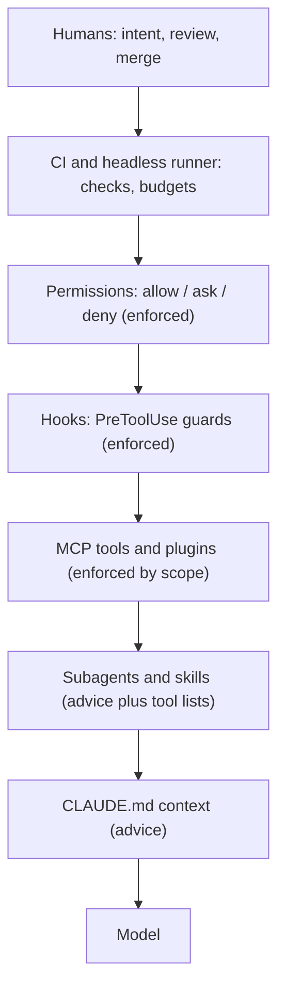

# Harness anatomy

A harness has layers. Each layer has one job, one file (or system) that defines it and one owner. Knowing the layers tells you where to put a control and who must review a change to it.

## The layers

From the inside out:

1. **Model.** Produces text and tool calls. You choose it (`sonnet`, `opus`, `haiku`) and an effort level. You do not control its internals.
2. **Context.** `CLAUDE.md` files and imports, loaded at session start. Advice the model usually follows. See [02-context-and-memory.md](02-context-and-memory.md).
3. **Skills.** Folders with a `SKILL.md`, loaded when the description matches the task, or run as `/<name>`.
4. **Subagents.** Markdown files with frontmatter. Each runs in its own context window. Subagents cannot spawn other subagents.
5. **Hooks.** Commands the harness runs on events. They can block a tool call. See [04-hooks-and-guardrails.md](04-hooks-and-guardrails.md).
6. **Permissions.** `allow`, `ask` and `deny` rules plus a default mode. Enforced by the harness, not by the model. See [05-permissions-and-sandboxing.md](05-permissions-and-sandboxing.md).
7. **MCP tools.** External tools named `mcp__<server>__<tool>`. See [06-mcp-and-connectors.md](06-mcp-and-connectors.md).
8. **Plugins.** Bundles of commands, agents, skills, hooks and MCP servers.
9. **CI and the headless runner.** `claude -p` in a pipeline, for example through `anthropics/claude-code-action`.
10. **Humans.** Reviewers, owners and approvers. The last layer and the only one that can be held accountable.

## Where control sits

The key distinction: some layers advise and some layers enforce. Advice can be ignored by a confused or manipulated model. Enforcement cannot.

Read the diagram from the top: a control higher up wins over one lower down. A `deny` rule beats any instruction in `CLAUDE.md`. A branch protection rule beats any permission on a laptop.

Rule of thumb: put anything that must always hold in permissions, hooks or branch protection. Put anything that should usually hold in `CLAUDE.md`.

## Ownership table

| Layer | File | Who owns it | Changes reviewed by |
| --- | --- | --- | --- |
| Context | `CLAUDE.md`, `CLAUDE.local.md` (git-ignored) | Tech lead | Code owners of the repo root |
| Context (user) | `~/.claude/CLAUDE.md` | The individual | Nobody (personal, not shared) |
| Skills | `.claude/skills/<name>/SKILL.md` | Platform or team lead | Platform team via CODEOWNERS |
| Subagents | `.claude/agents/*.md` | Platform or team lead | Platform team, plus security for reviewers |
| Hooks | `.claude/hooks/*`, `hooks` in settings | Platform or security | Security team via CODEOWNERS |
| Permissions | `.claude/settings.json` | Platform or security | Security team via CODEOWNERS |
| Local overrides | `.claude/settings.local.json` (git-ignored) | The individual | Nobody; must not widen managed policy |
| Org policy | `managed-settings.json` | Security or IT | Change control for the org |
| MCP servers | `.mcp.json` | Platform | Security team |
| CI | `.github/workflows/*.yml` | Platform | Platform and security |
| Branch rules | Repository settings | Repo admins | Org admins |

In this playbook the reference files for the project layers are in [templates/](../templates/README.md). The settings file is [templates/claude/settings.json](../templates/claude/settings.json).

## Settings precedence

Settings merge from several files. Higher entries win:

1. `managed-settings.json` (enterprise policy)
2. Command-line arguments
3. `.claude/settings.local.json` (project, git-ignored)
4. `.claude/settings.json` (project, committed)
5. `~/.claude/settings.json` (user)

A `deny` anywhere stays a `deny`. Managed policy cannot be loosened by anything below it.

## What a mistake looks like at each layer

| Layer | Typical failure | First control to check |
| --- | --- | --- |
| Context | Outdated build command in `CLAUDE.md` | PR review of `CLAUDE.md` |
| Skill | Description too broad, fires on every task | Skill review, narrower description |
| Subagent | Tool list inherited, so it can write | `tools:` line in frontmatter |
| Hook | Slow or fail-open guard | Hook tests, timeout |
| Permission | `Bash(*)` allowed on a laptop | Settings review, managed policy |
| MCP | Write token on a read-only task | Token scope |
| CI | Secret exposed to a fork PR | Workflow permissions |

## Checklist

- [ ] Every layer in the ownership table has a named owner in CODEOWNERS or the repo docs.
- [ ] `.claude/settings.json`, `.claude/hooks/`, `.claude/agents/`, `.claude/skills/` and `.mcp.json` are covered by CODEOWNERS.
- [ ] `.claude/settings.local.json` and `CLAUDE.local.md` are in `.gitignore`.
- [ ] Anything that must always hold is enforced by a permission, hook or branch rule, not only by `CLAUDE.md`.
- [ ] A new engineer can find, from this chapter alone, which file to edit for each kind of change.
- [ ] Organisation-wide rules are in managed settings, not copied into each repo.
