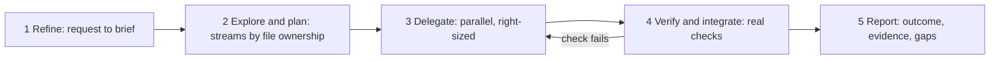

# Skills, subagents and orchestration

Claude Code gives you three ways to package repeatable work: skills, subagents and commands. This chapter says when to use each, then describes the orchestrate workflow this project uses for non-trivial tasks.

## Skill, subagent or command

| Need | Use | Why |
| --- | --- | --- |
| A procedure the main agent should follow, with checklists and reference files | Skill (`.claude/skills/<name>/SKILL.md`) | Loaded into the current context when the description matches |
| A separate worker with its own context and its own tool list | Subagent (`.claude/agents/<name>.md`) | Keeps noisy work out of the main context and can be restricted |
| A fixed prompt you trigger by name | Command (a Markdown file in `.claude/commands/`, or a skill run as `/<name>`) | Predictable, explicit start |
| Something that must happen every time, with no model judgment | Hook | See [04-hooks-and-guardrails.md](04-hooks-and-guardrails.md) |

Notes:

- A skill description decides when it loads. Write it as a trigger: what task, what words. A vague description fires on everything.
- A subagent starts cold. It sees only its brief, not your conversation.
- Subagents cannot spawn other subagents. Orchestration happens in the main thread.
- Restrict a subagent with `tools:` in its frontmatter. A reviewer that cannot write is safer than one told not to.

## Reference subagents

Two reviewer definitions ship with this playbook in [templates/agents/](../templates/agents/code-reviewer.md):

- [code-reviewer.md](../templates/agents/code-reviewer.md): correctness and maintainability, read-only tools.
- [security-reviewer.md](../templates/agents/security-reviewer.md): secrets, injection, permissions and supply chain, read-only tools.

## The orchestrate workflow

The standard is in [templates/skills/orchestrate/SKILL.md](../templates/skills/orchestrate/SKILL.md). It has five steps.



1. **Refine.** Turn the request into a brief with a goal, deliverables, checkable acceptance criteria and stated assumptions. Template: [templates/briefs/refined-brief.md](../templates/briefs/refined-brief.md).
2. **Explore, then plan.** Read before writing. Split work into streams by file ownership.
3. **Delegate in parallel, right-sized.** Launch independent subagents together. Set model and effort on each. Each gets a brief ([templates/briefs/subagent-brief.md](../templates/briefs/subagent-brief.md)).
4. **Verify and integrate.** Read the results, inspect the changed files, run the real checks once on the combined result.
5. **Report.** What is now true, how it was verified, what was not, and the next decision for the human.

## Model and effort table

| Work | Model | Effort |
| --- | --- | --- |
| Find files, grep, read-only lookups | haiku | low |
| Mechanical edits from exact instructions | sonnet | low |
| Well-specified implementation, tests from a spec, docs from an outline | sonnet | medium |
| Multi-file judgment, unclear bugs, code or security review | opus | high |
| Architecture trade-offs, subtle correctness | opus | xhigh, rarely |

Never use `max` unless a person asks. If an attempt fails, fix the brief before raising the level. A stronger model at lower effort often beats a weaker one at high effort when judgment is needed.

## File ownership makes parallel work safe

Two writers on one file produce conflicts and silent overwrites. Before delegating, assign each file to exactly one stream.

| Stream | Owns | Must not touch |
| --- | --- | --- |
| A: hooks | `.claude/hooks/**`, `tests/hooks.Tests.ps1` | `.github/**` |
| B: CI | `.github/workflows/**` | `.claude/**` |
| C: docs | `docs/**`, `README.md` | code and tests |

Each subagent brief lists "you own" and "do not touch". If two tasks need one file, run them in sequence.

## Worktree isolation

When writers might overlap, give each its own git worktree so edits cannot collide on disk. The orchestrator merges the branches after review. Use isolation for risky or long-running writers. It is not needed for read-only agents.

## Bounded verification

Every subagent brief ends with a verification step that is bounded:

- The exact commands to run (for example `pwsh -File tests/Invoke-Tests.ps1`).
- Stop when they pass. No extra research, alternative designs or "while I am here" changes.
- If they fail twice for the same reason, stop and report, do not loop.

This is principle 4 and principle 8 from [00-principles.md](00-principles.md) in one rule.

## Report format

Every subagent and the final orchestrator report use the same short shape:

```markdown
## Result
One line: done, partly done or blocked.

## Changed
- path/to/file: what and why

## Verified
- command: result (numbers)

## Not verified
- what, and why

## Decision for you
- the one thing a human must choose
```

## Checklist

- [ ] The orchestrate skill is committed under `.claude/skills/orchestrate/`.
- [ ] Reviewer subagents have an explicit `tools:` line without write tools.
- [ ] Every subagent brief names owned files, forbidden files and a bounded verification command.
- [ ] Model and effort are set explicitly per subagent, from the table.
- [ ] No two parallel streams own the same file.
- [ ] Final reports contain Verified and Not verified sections.
- [ ] Skill descriptions are specific enough that they do not fire on unrelated tasks.
