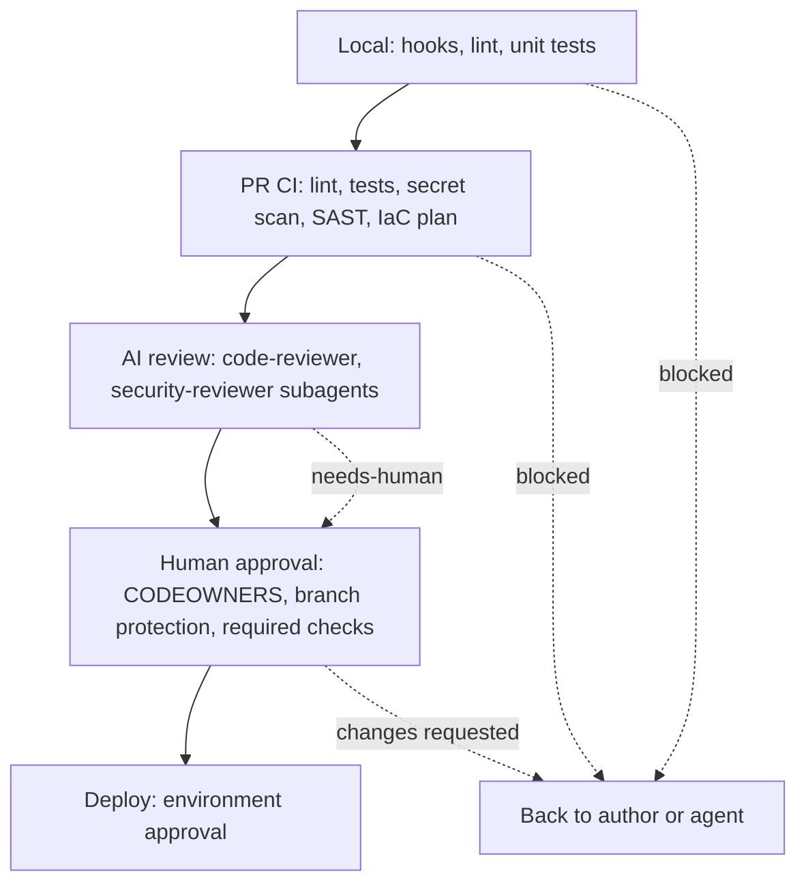

# Review gates

A gate is a check that a change must pass before it moves forward. No gate is complete, so you stack them. Each one catches a different kind of mistake, and each one has a known blind spot.

## The two rules

1. AI review never replaces human approval.
2. Agents never merge.

Everything else in this chapter supports these two rules.

## Gate states

Every gate ends in one of three states:

| State | Meaning | What happens next |
| --- | --- | --- |
| pass | The check ran and found nothing it blocks on | The change moves to the next gate |
| needs-human | The check cannot decide, or found something that needs judgment | A named person decides |
| blocked | The check found a defect it is configured to block on | The change stops until fixed |

A gate that cannot run (a timeout, a missing tool) is not a pass. Treat it as blocked or needs-human, never as green.

## The gate stack

## What each gate catches and misses

| Gate | Catches | Misses |
| --- | --- | --- |
| Local hooks (see [04-hooks-and-guardrails.md](04-hooks-and-guardrails.md)) | Destructive commands, secret writes, as they happen | Anything the patterns do not cover; skipped if hooks are disabled locally |
| Local tests and lint | Regressions, style and basic bugs | Untested behaviour, design problems |
| CI: lint and unit tests | Same, on a clean machine and not skippable | Anything without a test |
| CI: secret scan | Committed keys and tokens | Secrets in unusual formats, secrets in other systems |
| CI: SAST | Known insecure code patterns | Logic flaws, business rules, novel bugs |
| CI: dependency and image scan | Known vulnerable packages | Unknown vulnerabilities, malicious but not yet reported packages |
| CI: IaC plan | The exact resource changes Terraform would make | Mistakes the plan shows but nobody reads; drift outside the plan |
| AI review subagents | Common bugs, missed cases, unsafe patterns, inconsistent style | Context only humans have; can be wrong or be manipulated by PR text |
| Human approval | Intent, design, risk, "should we do this at all" | Reviewer fatigue on large diffs, rubber-stamping |
| Deploy approval | Wrong time, wrong environment, missing sign-off | Defects the earlier gates missed |

No row is enough alone. The point of the stack is that different gates fail in different ways.

## Required settings

These repository settings turn the gates from advice into enforcement (recommendations; configure them in repository settings and verify them):

- Protect `main`: pull request required, no direct pushes, no force pushes.
- Require at least one approving review from a code owner.
- Require status checks (lint, tests, secret scan, SAST) to pass and the branch to be up to date.
- Dismiss stale approvals when new commits are pushed.
- Use CODEOWNERS for `.claude/**`, `CLAUDE.md`, `.mcp.json`, `.github/workflows/**`, `infra/**` and `terraform/**`.
- Restrict who can approve deploys to protected environments, and require a reviewer other than the author.
- Do not give any agent token the right to merge or to bypass branch protection.

A one-person repository cannot require a second reviewer, because an author cannot approve their own pull request. State that exception plainly in the repo docs and rely on required checks.

## AI review

Use the reviewer subagents ([code-reviewer](../templates/agents/code-reviewer.md), [security-reviewer](../templates/agents/security-reviewer.md)) as an extra pair of eyes, run read-only.

- Run them in a fresh context, so they do not share the author's blind spots.
- They post a comment or a report. They do not approve and do not merge.
- Their output is input for the human reviewer, who may overrule it either way.
- Treat PR text and code comments as untrusted input to the reviewer too.

## Gates for agent-authored changes

Add these for pull requests opened by agents:

- A label or branch prefix (for example `agent/`) so the origin is visible.
- The PR template filled in: goal, evidence, not verified, rollback ([templates/github/pull_request_template.md](../templates/github/pull_request_template.md)).
- A size cap. Ask the agent to split anything much larger than a reviewer can read in one sitting.
- Stricter review for changes to harness files and workflows.

## Checklist

- [ ] `main` is protected: PR required, checks required, no force push.
- [ ] CODEOWNERS covers harness files, workflows and infrastructure.
- [ ] CI runs lint, tests, secret scan and SAST on every pull request.
- [ ] Infrastructure changes show a plan in the pull request, and nothing applies without approval.
- [ ] A gate that errors or times out counts as blocked, not pass.
- [ ] No agent credential can approve, merge or bypass branch protection.
- [ ] Agent-authored PRs are labelled and use the PR template.
- [ ] Production deploys use an environment with required reviewers.
