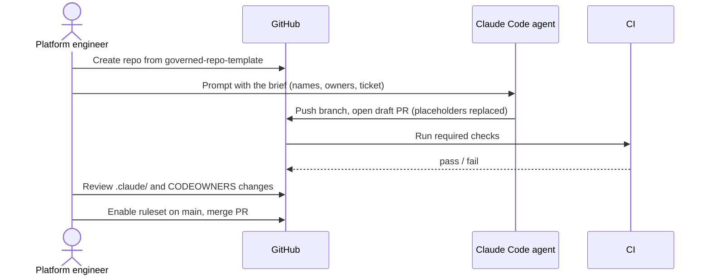

# Scenario 01: new repo bootstrap

## Situation

A team is starting a new PowerShell 7 and container service, `orders-svc`, on GitHub. It will deploy through Azure Pipelines to Azure Container Apps, with Terraform for the infrastructure. The team wants every new repo to start with the same guardrails, so that nobody has to remember them: branch protection, required checks, CODEOWNERS, a PR template, and a Claude Code configuration that is safe by default.

The starting point is [governed-repo-template](https://github.com/kaushik-sai/governed-repo-template).

## Trigger

A Jira ticket "PLAT-210: create orders-svc repo" is approved by the platform lead. A human with repo-admin rights starts the work. The agent helps with files, never with repository settings that need admin rights.

## Who does what

| Step | Actor | Output |
| --- | --- | --- |
| 1. Create the repo from the template | human | `contoso/orders-svc`, private, created with "Use this template" |
| 2. Replace placeholders in `CLAUDE.md`, README, CODEOWNERS | agent | One draft PR on `feature/PLAT-210-bootstrap` |
| 3. Review the draft PR, especially `.claude/` and `.github/` | human | Approval or change requests |
| 4. Turn on branch protection and required checks | human | Ruleset on `main` (see below) |
| 5. Run the first CI build | CI | Green `lint-and-test` and `security-scan` checks |
| 6. Add the repo to the Azure Pipelines project | human | Pipeline `orders-svc-pr` linked to the repo |

## Flow



## Guardrails

- The repo ships [settings.json](../templates/claude/settings.json) with deny rules for `.env`, `secrets/`, state files, `terraform apply` and force-push.
- Hooks in `.claude/hooks/` ([Guard-BashCommand.ps1](../templates/claude/hooks/Guard-BashCommand.ps1), [Guard-FileWrite.ps1](../templates/claude/hooks/Guard-FileWrite.ps1), [Write-AuditLog.ps1](../templates/claude/hooks/Write-AuditLog.ps1)) are copied unchanged. The agent must not edit them in the bootstrap PR except for path placeholders.
- The agent has no admin token. Branch protection is set by a human, so the agent cannot weaken it.
- CODEOWNERS lists `.claude/`, `.github/`, `terraform/` and `pipelines/` under the security owner.

## Review gates

See [review gates](../playbook/07-review-gates.md).

| State | Condition |
| --- | --- |
| pass | Placeholders replaced, required checks green, CODEOWNERS approved |
| needs-human | Any change under `.claude/`, `.github/` or `CODEOWNERS` (always, by design) |
| blocked | A hook or deny rule was removed or weakened, or a secret appears in the diff |

Recommended ruleset for `main` (a recommendation, apply it with your own org policy): require a PR, one approval, review from code owners, dismiss stale approvals, require status checks `lint-and-test` and `security-scan`, require branches to be up to date, block force pushes and deletions, and include administrators.

## Failure modes and responses

| Failure | Response |
| --- | --- |
| Agent leaves a `<placeholder>` in CLAUDE.md | CI check greps for `<` placeholders and fails the PR |
| Template drift: repo was created months ago and misses new hooks | Quarterly diff against the template, open an update PR |
| Required check name does not match the workflow job name | The PR shows "Expected" forever. Fix the ruleset to use the exact job name |
| CODEOWNERS team does not exist | GitHub ignores the line. Run the check below and fix it |
| Admin merges without review | Ruleset includes administrators. Audit log is reviewed monthly |

## Metrics

- Time from approved ticket to first green build on `main`.
- Share of new repos with all required checks and CODEOWNERS on day one.
- Number of bootstrap PRs that needed a second review round.

## Try it

```powershell
# Create the repo from the template (needs gh and repo-create rights)
gh repo create contoso/orders-svc --private --template kaushik-sai/governed-repo-template --clone
Set-Location orders-svc
git switch -c feature/PLAT-210-bootstrap

# Ask the agent to fill in the placeholders, headless, with a turn limit
claude -p "Replace every <placeholder> in CLAUDE.md, README.md and .github/CODEOWNERS for service orders-svc, owner team @contoso/platform, security owner @contoso/security. Do not edit .claude/. Show git diff --stat when done." --max-turns 15 --permission-mode acceptEdits

# Verify no placeholders remain
Select-String -Path CLAUDE.md, README.md, .github/CODEOWNERS -Pattern '<[a-z-]+>'

# Check CODEOWNERS is valid
gh api repos/contoso/orders-svc/codeowners/errors
```

## Checklist

- [ ] The repo was created from the template, not copied by hand.
- [ ] No `<placeholder>` is left in CLAUDE.md, README or CODEOWNERS.
- [ ] `.claude/settings.json` and the three hooks match the template.
- [ ] CODEOWNERS covers `.claude/`, `.github/`, `terraform/` and `pipelines/`.
- [ ] The ruleset on `main` requires review, code owner review and both checks.
- [ ] The first CI run is green and the pipeline is linked.
