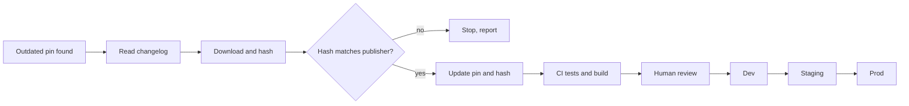

# Scenario 04: dependency upgrade

## Situation

`orders-svc` pins everything: PowerShell modules (Pester, PSScriptAnalyzer, Pode), the base image, GitHub Actions and the Terraform provider. A scheduled job finds that Pode `2.11.0` has a newer release, and the base image has a security patch. The team wants the upgrade done carefully: exact versions, checksums, a changelog read, and a staged rollout. The agent does the legwork and a human decides.

## Trigger

A weekly scheduled workflow lists outdated pins and opens one Jira ticket per upgrade group (for example PLAT-377 "Upgrade Pode"). A human labels the ticket `agent-ok`. The upgrade then follows [scenario 02](02-ticket-to-pr.md).

## Who does what

| Step | Actor | Output |
| --- | --- | --- |
| 1. Detect outdated pins | CI | List of current vs available versions |
| 2. Read the release notes and changelog of the new version | agent | Summary with breaking changes and security fixes, linked to the source |
| 3. Download the artifact and compute SHA-256 | agent | Hash recorded in the PR next to the version |
| 4. Compare with the publisher's checksum or signature if one exists | agent | Match, mismatch or "none published" |
| 5. Update the pin and the hash in the lockfile or `versions.psd1` | agent | One-line diffs |
| 6. Run the full tests and the container build | CI | pass or fail |
| 7. Review the summary, the hash and the diff | human | Approve or reject |
| 8. Roll out dev, then staging, then prod | human, with pipeline | Promotion of one image tag |

## Flow



## Guardrails

- Only exact versions and full SHA-256 values are accepted. `latest`, `^`, `~`, `*` and unpinned actions are rejected by a CI check and by the [security reviewer](../templates/agents/security-reviewer.md).
- Network access is limited by the permission rules in [settings.json](../templates/claude/settings.json): `WebFetch(domain:...)` only for the registries and release pages the repo uses.
- The release notes are untrusted input. The agent summarises them but does not run install scripts or commands from them.
- [Guard-BashCommand.ps1](../templates/claude/hooks/Guard-BashCommand.ps1) blocks `curl | sh`, `Invoke-Expression` on downloaded content and `Install-Module` without `-RequiredVersion`.
- One upgrade group per PR. A base image bump and a library bump are separate PRs.

## Review gates

See [review gates](../playbook/07-review-gates.md).

| State | Condition |
| --- | --- |
| pass | Hash verified, tests and scans green, no breaking change affects used APIs, patch or minor version |
| needs-human | Major version, any breaking change, or no publisher checksum to compare with |
| blocked | Hash mismatch, new transitive dependency from an unknown publisher, or a security scan finding that was not there before |

## Failure modes and responses

| Failure | Response |
| --- | --- |
| Hash does not match the publisher | Stop. Report both values. Do not retry from a mirror |
| Changelog is missing or vague | Mark needs-human. Do not guess what changed |
| Tests pass but behaviour changed in production only | Staged rollout catches it in dev or staging. Roll back by redeploying the previous image tag |
| Typosquatted package name | Reviewer compares publisher and name with the old pin. Mismatch is blocked |
| Upgrade needs a config change | Include it in the same PR with a test, or split into a prior PR |

## Metrics

- Age of the oldest pin in the repo.
- Time from a published security fix to prod.
- Share of upgrade PRs rolled back or reverted.
- Number of hash mismatches found (each one is worth a note).

## Try it

```powershell
# Show the current pin
Select-String -Path versions.psd1 -Pattern 'Pode'

# Hash a downloaded artifact yourself, independent of the agent
Save-Module -Name Pode -RequiredVersion 2.12.0 -Path $env:TEMP/pode -Repository PSGallery
Get-ChildItem $env:TEMP/pode/Pode/2.12.0 -Recurse -File |
    Get-FileHash -Algorithm SHA256 | Select-Object -First 5

# Ask the agent for the summary and the diff
claude -p "Upgrade Pode from 2.11.0 to 2.12.0 in versions.psd1. Read the release notes, list breaking changes and security fixes with links, record the SHA-256 in the file, run Invoke-Pester ./tests -CI. Do not touch other pins." --max-turns 25 --permission-mode acceptEdits

# Staged rollout is done by the release pipeline, one stage at a time
# dev -> staging -> prod, promoting the same image tag (built once)
```

## Checklist

- [ ] The new version and its SHA-256 are both in the diff.
- [ ] The hash was compared with a publisher source, or "none published" is written in the PR.
- [ ] The changelog summary links to the source and lists breaking changes.
- [ ] Only one upgrade group is in the PR.
- [ ] The same image tag is promoted dev, staging, prod.
- [ ] A rollback to the previous tag was tried in dev.
