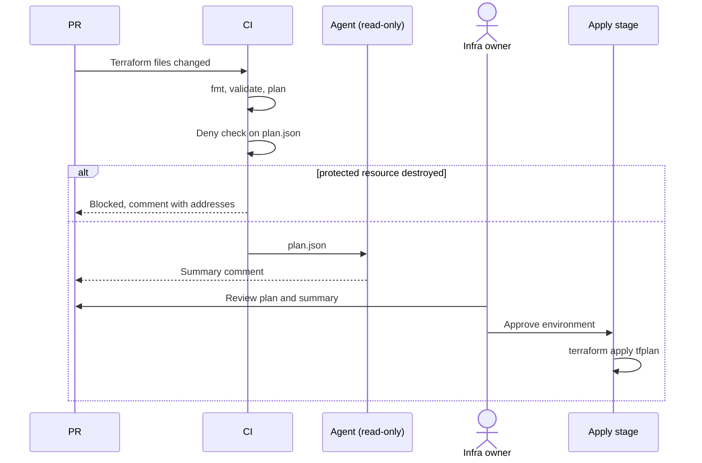

# Scenario 05: infrastructure change review

## Situation

A developer changes the Terraform for `orders-svc` on Azure: add a Key Vault secret reference, widen a storage firewall, rename a resource. Infrastructure mistakes are costly and often irreversible (a destroyed database, a public storage account). The team wants a plan on every PR, a readable summary of it, and a hard stop on dangerous changes. The agent can explain a plan. It can never apply one.

## Trigger

A PR changes files under `terraform/`. The pipeline runs `terraform plan` and saves the result as a JSON plan file.

## Who does what

| Step | Actor | Output |
| --- | --- | --- |
| 1. `terraform fmt -check`, `init`, `validate`, `plan -out=tfplan` | CI | `tfplan` and `plan.json` (from `terraform show -json`) |
| 2. Scan the plan for protected resource types being destroyed or replaced | CI | `deny` result and a list of addresses |
| 3. Summarise the plan in plain words: adds, changes, destroys, risk | agent | PR comment (read-only access to `plan.json`) |
| 4. Review the plan and the summary | human (infra owner) | Approval in the protected environment |
| 5. Apply | pipeline, after approval | Applied state. Never the agent |

## Flow



## Guardrails

- [settings.json](../templates/claude/settings.json) denies `terraform apply`, `terraform destroy`, `terraform state`, `terraform import` and reading `*.tfstate` and `*.tfvars`. The agent only has `Read` on `plan.json` and the `.tf` files.
- The plan job uses a read-only Azure role (Reader plus state read). The apply job uses a different identity, in a protected environment with required reviewers. The agent has no access to it.
- The deny check is plain code, not a prompt. Example, run in CI: a script reads `plan.json` and fails if any `resource_changes` entry of type `azurerm_key_vault`, `azurerm_mssql_database`, `azurerm_storage_account` or `azurerm_postgresql_flexible_server` has `delete` in its `actions`.
- Apply uses the saved `tfplan` file, so what was reviewed is what runs.
- Use [security-reviewer](../templates/agents/security-reviewer.md) on every `terraform/` diff for open network rules and disabled protections.

## Review gates

See [review gates](../playbook/07-review-gates.md).

| State | Condition |
| --- | --- |
| pass | Plan has only adds or in-place changes to non-protected resources, no security finding, infra owner approves |
| needs-human | Any destroy or replace, any change to identity, network or Key Vault access policy |
| blocked | Destroy or replace of a protected resource, plan fails, state drift not explained, or the agent summary disagrees with the deny check |

## Failure modes and responses

| Failure | Response |
| --- | --- |
| Rename causes destroy and create | Deny check blocks. Use a `moved` block and re-plan |
| Plan differs from what ran (stale plan) | Apply uses the saved plan file and fails if state changed. Re-plan |
| Agent summary understates risk | The deny check and the raw plan are the source of truth. Reviewer reads the plan itself |
| Secret value appears in plan output | Mark variables `sensitive`, mask in logs, rotate the secret |
| Drift between code and Azure | Report in the PR. A human decides whether to import or revert |

## Metrics

- Share of Terraform PRs with a plan comment within 10 minutes.
- Number of blocked destroys of protected resources (each one is read).
- Plans applied that differ from the reviewed plan (target: zero).
- Time from PR to apply.

## Try it

```powershell
Set-Location terraform
terraform fmt -check -recursive
terraform init -backend=false
terraform validate
terraform plan -out=tfplan
terraform show -json tfplan > plan.json

# Deny check: list protected resources that would be deleted
$protected = 'azurerm_key_vault','azurerm_mssql_database','azurerm_storage_account','azurerm_postgresql_flexible_server'
$hits = (Get-Content plan.json -Raw | ConvertFrom-Json).resource_changes |
    Where-Object { $_.type -in $protected -and $_.change.actions -contains 'delete' }
if ($hits) { $hits.address; exit 1 }

# Agent summary, read-only, no edits
claude -p "Read terraform/plan.json. Summarise adds, changes and destroys in plain words, list the riskiest change first, and say what you could not tell from the plan. Do not run terraform." --allowedTools "Read" --max-turns 5
```

## Checklist

- [ ] A plan is produced on every PR that touches `terraform/`.
- [ ] The deny check runs on `plan.json` and fails the job on a protected destroy.
- [ ] The agent has no write role, no state access and no apply permission.
- [ ] Apply runs from the saved plan, in a protected environment with required reviewers.
- [ ] State is remote with locking, encrypted, and not readable by the agent.
- [ ] The agent summary is treated as help, and the human reads the plan.
