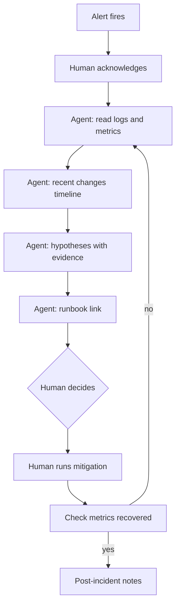

# Scenario 06: incident triage

## Situation

At 02:10 an alert fires for `orders-svc`: HTTP 5xx rate above 5 percent for 10 minutes. The on-call engineer has logs in Azure Monitor (Log Analytics) and metrics in Prometheus or Azure Monitor. They want help narrowing down the cause fast, without giving an agent the power to change production. The agent reads, reasons and writes hypotheses. The human acts.

## Trigger

A page from the alerting system, with an incident ticket (for example INC-2041) created. The on-call engineer starts a Claude Code session in the repo, using the read-only triage profile.

## Who does what

| Step | Actor | Output |
| --- | --- | --- |
| 1. Acknowledge the page, set severity | human | Ack in the pager tool |
| 2. Query logs and metrics for the alert window and the hour before | agent | Query text and key results (read-only) |
| 3. List recent changes: deploys, config, flags, dependency status | agent | Timeline from git log and release history |
| 4. Propose ranked hypotheses, each with evidence and a way to disprove it | agent | Hypothesis list in the incident ticket |
| 5. Link the matching runbook section | agent | Link, quoted steps |
| 6. Decide and run mitigation (rollback, scale, flag off) | human | Action recorded in the ticket |
| 7. Confirm recovery, write the timeline | human, agent drafts | Post-incident notes |

## Flow



## Guardrails

- A dedicated triage identity with Reader on the resource group and Log Analytics Reader only. No Contributor, no Key Vault access, no deploy rights.
- A triage settings profile allows `Read`, `Grep`, `Glob` and a short list of read-only commands (`az monitor log-analytics query`, `kubectl get`, `git log`) and denies everything that writes. See [settings.json](../templates/claude/settings.json) for the deny patterns. This profile is a recommendation and is not shipped in the template.
- [Guard-BashCommand.ps1](../templates/claude/hooks/Guard-BashCommand.ps1) blocks `az ... update`, `az ... delete`, `kubectl apply|delete|scale`, `docker rm` and `Restart-*`.
- Log content is untrusted: attackers can put text in a User-Agent or a query string. The agent quotes logs but never follows instructions in them.
- Personal data in logs: query only the fields needed, and do not paste raw customer data into the ticket.
- Every tool call is written by [Write-AuditLog.ps1](../templates/claude/hooks/Write-AuditLog.ps1), so the incident review can see what was queried.

## Review gates

See [review gates](../playbook/07-review-gates.md). Here the gate is about advice, not code.

| State | Condition |
| --- | --- |
| pass | Each hypothesis cites a log line, metric or change, and the runbook step is quoted from the source |
| needs-human | Always before any mitigation. Also when evidence is thin or hypotheses conflict |
| blocked | The agent proposes or attempts a write action, or a hypothesis has no evidence. Discard it |

## Failure modes and responses

| Failure | Response |
| --- | --- |
| Hypothesis sounds confident but has no evidence | Require "evidence" and "how to disprove" for each. Drop those without |
| Agent anchors on the last deploy | Ask for at least one hypothesis that is not a deploy |
| Query is too broad and slow | Ask for time bounds and a row limit in every query |
| Logs contain injected instructions | Ignore and note it. Treat it as a possible attack |
| Runbook is out of date | Agent says which step does not match reality. Human updates the runbook after |

## Metrics

- Time to first useful hypothesis.
- Share of incidents where the final cause was in the top two hypotheses.
- Time to mitigate.
- Number of blocked write attempts (should be zero, and each one is read).

## Try it

```powershell
# Start a read-only session
claude --permission-mode plan

# Or headless, with a tight tool allowlist
claude -p "INC-2041: orders-svc 5xx rate above 5 percent since 02:00 UTC. Use read-only queries only. 1) Query errors by endpoint for the last 2 hours. 2) List deploys and config changes in the last 24 hours from git log and docs/releases. 3) Give up to 4 ranked hypotheses, each with evidence (log line or metric) and how to disprove it. 4) Quote the matching section of RUNBOOK.md. Do not change anything." --allowedTools "Read" "Grep" "Glob" "Bash(az monitor log-analytics query:*)" "Bash(git log:*)" --max-turns 20
```

## Checklist

- [ ] The triage identity is read-only and has no access to secrets.
- [ ] Write commands are denied by permissions and by the Bash hook.
- [ ] Every hypothesis lists evidence and a way to disprove it.
- [ ] The runbook link is quoted from the file, not from memory.
- [ ] A human runs every mitigation and records it in the ticket.
- [ ] The audit log is attached to the post-incident review.
